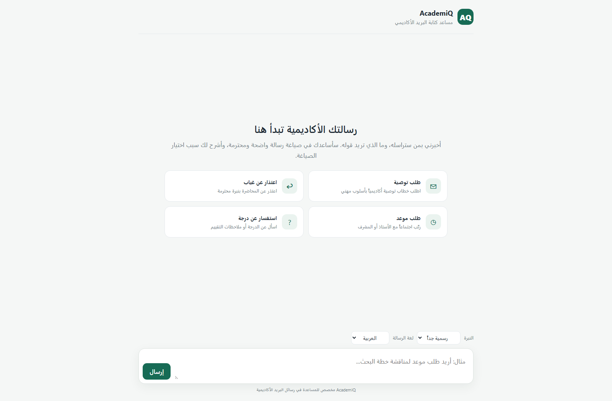
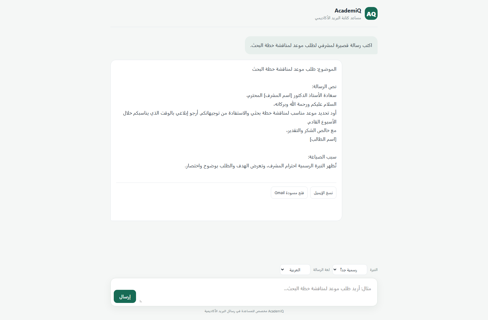
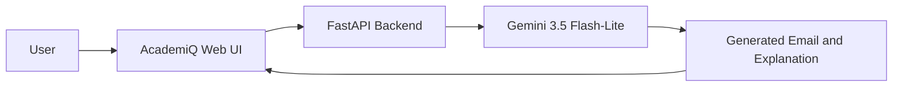

# AcademiQ — Academic Email Assistant


AcademiQ is an AI-powered assistant that helps students and researchers draft and refine professional academic emails to professors, supervisors, and academic staff. It supports Arabic and English, offers several tone presets, explains its wording choices, and keeps each conversation in a separate in-memory session.

> **الملخص بالعربية:** AcademiQ مساعد أكاديمي لصياغة ومراجعة رسائل البريد الرسمية الموجهة للأساتذة والمشرفين. يدعم العربية والإنجليزية، ويوفر خيارات متعددة للنبرة، مع توضيح أسباب الصياغة وحواجز تحدّ من استخدامه خارج نطاق البريد الأكاديمي.

## Screenshots

The landing page shows the quick-prompt cards. They disappear after the first message, so the completed conversation is shown separately.



## Features

- **Academic email focus:** Helps draft, revise, and improve emails such as meeting requests, recommendation requests, apologies, and questions about coursework or grades.
- **Strict scope guardrails:** The system prompt limits assistance to academic email writing and provides a fixed refusal for unrelated requests.
- **Tone presets:** Choose very formal, friendly, urgent, or apologetic wording.
- **Arabic and English:** Select the language of the generated email from the interface.
- **Interactive web interface:** A responsive Arabic-first chat UI served by FastAPI.
- **Copy and Gmail draft actions:** Copy the generated response or open a Gmail compose window with the detected subject and email text.
- **Separate conversations:** The browser creates a session ID and the backend keeps chat context per session in memory.
- **Server-side API key:** Gemini credentials are read from environment variables and are not sent to the browser.

## Architecture



The FastAPI application serves the interface at `/` and exposes the chat endpoint at `/chat`. Conversation state is held in the server process; restarting the server clears active sessions.

## Tech Stack

| Layer | Technology | Use |
| --- | --- | --- |
| Backend | Python, FastAPI | Serves the UI and provides the chat API |
| Validation and API schema | Pydantic | Validates incoming chat requests |
| LLM integration | Google Gen AI Python SDK (`google-genai`) | Sends prompts to the configured Gemini model |
| Default model | `gemini-3.5-flash-lite` | Fast, cost-conscious email generation; configurable with `GEMINI_MODEL` |
| Frontend | HTML, CSS, vanilla JavaScript | Chat interface, tone and language selection, clipboard and Gmail actions |
| Configuration | `python-dotenv` and environment variables | Loads local API credentials from `.env` |
| Development server | Uvicorn | Runs the FastAPI application locally |
| Session storage | In-memory Python dictionary | Separates chat histories by `session_id` for the current process lifetime |

## Requirements

- Python 3.10 or newer
- A Gemini API key from [Google AI Studio](https://aistudio.google.com/app/apikey)
- Internet access for package installation and Gemini API requests

## Installation and Setup

### 1. Clone the repository

```bash
git clone <your-repository-url>
cd <repository-folder>
```

### 2. Create and activate a virtual environment

**Windows PowerShell:**

```powershell
py -m venv .venv
.\.venv\Scripts\Activate.ps1
```

**macOS / Linux:**

```bash
python3 -m venv .venv
source .venv/bin/activate
```

### 3. Install dependencies

```bash
python -m pip install --upgrade pip
python -m pip install -r requirements.txt
```

### 4. Configure the Gemini API key

Copy `.env.example` to `.env` and replace the placeholder with your key:

**Windows PowerShell:**

```powershell
Copy-Item .env.example .env
```

**macOS / Linux:**

```bash
cp .env.example .env
```

Open `.env` and set one of the supported key variables:

```dotenv
GOOGLE_API_KEY=your_gemini_api_key
```

Alternatively, use `GEMINI_API_KEY`. If both are set, the application uses `GOOGLE_API_KEY`. You can optionally choose another model by setting `GEMINI_MODEL`; by default, AcademiQ uses `gemini-3.5-flash-lite`.

### 5. Start the application

```bash
python -m uvicorn main:app --reload --host 127.0.0.1 --port 8000
```

Open **http://127.0.0.1:8000** in your browser. The interactive API documentation is available at **http://127.0.0.1:8000/docs**.

Keep the terminal open while using the application. Stop the development server with **Ctrl+C**.

## API

### `POST /chat`

Request body:

```json
{
  "message": "I would like to request a meeting to discuss my research plan.",
  "session_id": "browser-generated-session-id",
  "tone": "formal",
  "language": "en"
}
```

Supported `tone` values: `formal`, `friendly`, `urgent`, `apology`.

Supported `language` values: `ar`, `en`.

The response includes the full assistant reply, plus `subject` and `email_body` fields used by the Gmail compose action.

## Configuration

| Variable | Required | Description |
| --- | --- | --- |
| `GOOGLE_API_KEY` | One API key is required | Google AI API key; takes precedence when both key variables are set |
| `GEMINI_API_KEY` | Alternative | Alternative name for the Google AI API key |
| `GEMINI_MODEL` | No | Gemini model ID; defaults to `gemini-3.5-flash-lite` |
| `FRONTEND_ORIGINS` | No | Comma-separated allowed frontend origins for local or separate frontend deployments |

## Troubleshooting

- **`uvicorn` is not recognized:** Activate `.venv`, then run the server with `python -m uvicorn ...` as shown above.
- **`Failed to fetch`:** Confirm the server is running and open the page from `http://127.0.0.1:8000`.
- **API key or permission error:** Check that `.env` contains a valid key and that Gemini API access is enabled for its Google project.
- **`429` response:** The API key has reached its current rate limit or quota. Review the quota and retry later.
- **`504 DEADLINE_EXCEEDED`:** Gemini did not finish before its deadline. Retry after a short wait; the model can also be changed with `GEMINI_MODEL`.

## Security and Privacy

- Keep `.env` private. It is excluded from Git by `.gitignore`; commit `.env.example` instead.
- Never place the Gemini API key in frontend code or share it in screenshots, logs, or public issues.
- If a key has ever been committed or shared, revoke it and create a replacement.
- The current session store is in memory and is not persistent. Chat history is cleared when the server process restarts.
- The scope guardrails are prompt-based and should not be treated as a substitute for human review of generated emails.

## Project Structure

```text
.
├── assets/
│   ├── academiq-home.png          # Landing page and quick-prompt cards
│   └── academiq-conversation.png  # Generated email conversation
├── main.py                        # FastAPI application and Gemini integration
├── index.html                     # Browser interface and client-side interactions
├── requirements.txt               # Python dependencies
├── .env.example                   # Safe environment-variable template
├── .gitignore                     # Excludes local secrets and development files
└── LICENSE                        # MIT License
```

## Roadmap

- Persist conversations with SQLite.
- Add automated tests for request validation and response formatting.
- Add deployment configuration and production-grade monitoring.

## License

No license has been added yet. Add a `LICENSE` file before redistributing this project.
